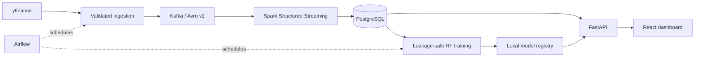

# Real-Time Stock Prediction Pipeline

Research-oriented stock data pipeline built with Kafka, Spark Structured
Streaming, PostgreSQL, Airflow, FastAPI, React and scikit-learn.

P0 establishes a reproducible and fail-closed foundation. The dashboard shows
data provenance and empty/error/stale states, model promotion requires beating
a zero-return baseline on holdout and walk-forward evaluation, and generated
signals are explicitly research-only. This repository is not an investment
advisory or automated-trading product.

## Architecture



## Repository layout

```text
apps/web/                         React dashboard
services/api/                     FastAPI dashboard API
packages/pipeline/src/
  stock_pipeline/                 Canonical Python application package
orchestration/airflow/dags/       Thin Airflow orchestration definitions
infrastructure/docker/            Runtime images
infrastructure/compose/           Environment-specific Compose configuration
infrastructure/migrations/        Versioned SQL migrations and rollbacks
scripts/                          Thin CLI/operations adapters
config/environments/              Sanitized environment templates
tests/                            Unit and integration tests
docs/                             Roadmap, ADRs, preflight and P0 evidence
artifacts/                         Local runtime output; ignored by Git
```

The namespaces under `src/` and `integrations/` are temporary compatibility
adapters. New code must import from `stock_pipeline`.

## Quick start

Prerequisites: Docker with Compose v2, Python 3.12 and Node.js 22.

```bash
cp .env.example .env
# Replace every placeholder secret in .env before starting services.

docker compose --env-file .env up -d postgres zookeeper kafka redis
PYTHONPATH=packages/pipeline/src python scripts/migrate.py up

docker compose --env-file .env up -d dashboard-backend dashboard-frontend
./scripts/ci/smoke_dashboard.sh
```

The dashboard is exposed only on `127.0.0.1:5173` by default and the API on
`127.0.0.1:8000`. Override `DASHBOARD_PORT` in the ignored local `.env` when
needed.

Start the streaming consumer after the database migration:

```bash
docker compose --env-file .env up -d --build spark-consumer
docker compose ps
docker compose logs --tail=100 spark-consumer
```

Run canonical application entrypoints from the host with the package on
`PYTHONPATH`:

```bash
export PYTHONPATH="$PWD/packages/pipeline/src:$PWD/src"
python -m stock_pipeline.ingestion.main
python scripts/run_train.py --model random_forest --days 90
python scripts/run_inference.py
python scripts/signal_generator.py
```

Training and inference abort when validated data or an eligible model is
unavailable. LSTM is retained as research code but is not promotion-eligible in
P0.

## Database migrations

The migration runner records checksums and uses a PostgreSQL advisory lock.

```bash
PYTHONPATH=packages/pipeline/src python scripts/migrate.py status
PYTHONPATH=packages/pipeline/src python scripts/migrate.py up
PYTHONPATH=packages/pipeline/src python scripts/migrate.py down
```

Seed SQL is separate from schema migration and is never applied implicitly.

## Dashboard contract

API responses use a stable `{data, state, meta}` envelope. Metadata includes
source, as-of time, timezone, market state, staleness and model version where
applicable. Missing data is reported as an empty state; database failures return
an error instead of fabricated ticker, price, confidence or portfolio values.

The legacy Dash UI under `src/dashboard/` is frozen. The supported product UI
is `apps/web/`.

## Validation

```bash
./scripts/ci/check_secrets.sh
python scripts/ci/validate_structured_files.py
python -m compileall -q packages/pipeline/src src services scripts tests orchestration
docker compose --env-file .env.example config --quiet

PYTHONPATH=packages/pipeline/src:src \
  python -m pytest -c tests/pytest.ini tests/unit \
  --ignore=tests/unit/test_batch_etl.py \
  --ignore=tests/unit/test_transformations.py

npm --prefix apps/web ci
npm --prefix apps/web run lint
npm --prefix apps/web run build
```

Spark-specific tests run inside the pinned Spark image; the exact command is in
`.github/workflows/p0-quality.yml`. CI also applies, rolls back and reapplies
migrations, audits Python dependencies, scans built images and smoke-tests the
dashboard.

## Optional CloudVault publication

CloudVault publication is disabled by default. It is a durable catalog for a
validated model bundle and compact research-signal report; local PostgreSQL and
the model registry remain operational sources. Configure its service account in
the ignored `.env`, create the `cloudvault-shared` Docker network, then enable
only the required publisher flag.

Restore is manual and checksum-verified:

```bash
docker compose exec airflow-scheduler \
  python /opt/airflow/scripts/restore_model.py \
  --manifest-file-id <manifest-file-id>
```

Use `--activate` only after review. Rollback selects an already verified local
version with `--rollback-to <version>`.

## Documentation

- [Upgrade roadmap](docs/upgrade-roadmap.md)
- [P0 implementation status](docs/p0-implementation-status.md)
- [Canonical runtime ADR](docs/adr/0001-canonical-runtime-architecture.md)
- [Preflight evidence and secret remediation](docs/preflight/README.md)
